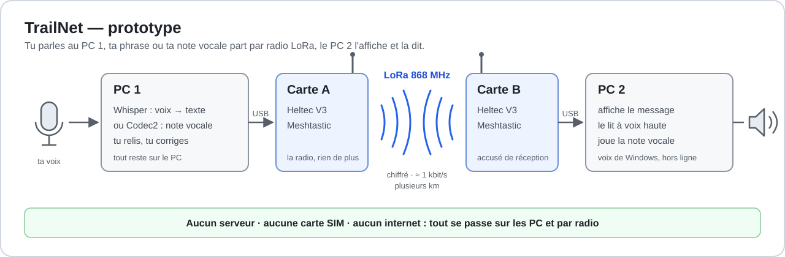

# TrailNet — prototype

**Tu parles à ton PC. Ta phrase part par radio LoRa, sans réseau mobile ni internet. À l'arrivée, elle s'affiche et se lit à voix haute.**

Deux cartes LoRa à 23 €, deux PC, un script Python. Pas de serveur, pas de carte SIM, pas d'abonnement, pas de compte. Ce dépôt contient tout ce qu'il faut pour refaire le montage chez toi, étape par étape, avec les vraies erreurs qu'on a rencontrées et comment on les a corrigées.



TrailNet vise un communicateur hors réseau pour la randonnée. Ce prototype en valide la première brique : **la parole transmise sous forme de texte**. Il sait aussi envoyer une **vraie note vocale**, compressée avec Codec2, pour comparer (étape 9). Le PC joue le rôle du futur ordinateur embarqué (micro, transcription, synthèse vocale) ; la carte LoRa n'est que la radio.

> ⚠ **Prototype de laboratoire.** Ce n'est pas un moyen d'alerte. En montagne, garde ton téléphone, le 112 et les moyens de secours officiels.

**Version du script : v1.7.1** (`py trailnet_pc.py --version`). Testé en vrai entre deux PC, dans les deux sens : la dictée, la réception, la lecture à voix haute et le mode conversation, messages longs en 2 et 3 paquets compris. Les notes vocales par radio sont testées hors carte ; l'essai réel est la prochaine étape.

**Par où commencer.** Un seul script, deux niveaux :

1. **Un sens** (étapes 1 à 8) : un PC dicte, l'autre affiche et lit à voix haute. C'est le montage le plus simple pour vérifier que tout fonctionne.
2. **Les deux sens** (étape 10) : `converser` sur chaque PC, et on se répond sans changer de commande, comme avec un talkie-walkie.

L'étape 9 (ta vraie voix, en Codec2) est facultative. Chaque version publiée reste téléchargeable dans les [Releases](https://github.com/diarrayelen-cell/TrailNet/releases) du dépôt.

---

## Sommaire

1. [Pourquoi envoyer du texte plutôt que la voix](#pourquoi-envoyer-du-texte-plutôt-que-la-voix)
2. [Ce qu'on a mesuré](#ce-quon-a-mesuré)
3. [Matériel](#matériel)
4. [Logiciels](#logiciels)
5. [Étape 0 — Deux règles avant de brancher quoi que ce soit](#étape-0--deux-règles-avant-de-brancher-quoi-que-ce-soit)
6. [Étape 1 — Installer Meshtastic sur les cartes](#étape-1--installer-meshtastic-sur-les-cartes)
7. [Étape 2 — Préparer chaque PC](#étape-2--préparer-chaque-pc)
8. [Étape 3 — Tester la transcription, sans carte](#étape-3--tester-la-transcription-sans-carte)
9. [Étape 4 — Brancher une carte et trouver son port](#étape-4--brancher-une-carte-et-trouver-son-port)
10. [Étape 5 — Région et nom des cartes](#étape-5--région-et-nom-des-cartes)
11. [Étape 6 — Créer ton canal privé](#étape-6--créer-ton-canal-privé)
12. [Étape 7 — Test 1 : dicter et recevoir](#étape-7--test-1--dicter-et-recevoir)
13. [Étape 8 — Test 2 : lecture à voix haute](#étape-8--test-2--lecture-à-voix-haute)
14. [Étape 9 — Ta vraie voix, en Codec2](#étape-9--ta-vraie-voix-en-codec2)
15. [Étape 10 — Converser dans la même fenêtre](#étape-10--converser-dans-la-même-fenêtre)
16. [Toutes les commandes](#toutes-les-commandes)
17. [Dépannage](#dépannage)
18. [Ce qui est protégé, ce qui ne l'est pas](#ce-qui-est-protégé-ce-qui-ne-lest-pas)
19. [Portée : à quoi t'attendre](#portée--à-quoi-tattendre)
20. [Réglementation : la règle des 10 %](#réglementation--la-règle-des-10-)
21. [Pour aller plus loin](#pour-aller-plus-loin)
22. [Ce qui existe déjà](#ce-qui-existe-déjà)
23. [Structure du dépôt, versions, auteurs, licence](#structure-du-dépôt)

---

## Pourquoi envoyer du texte plutôt que la voix

LoRa porte loin, mais son débit est minuscule : environ **1 kbit/s** avec le réglage par défaut de Meshtastic (LONG_FAST), et chaque paquet ne transporte qu'environ **230 octets**. En Europe, chaque carte n'a en plus le droit d'émettre que **10 % du temps** (voir [Réglementation](#réglementation--la-règle-des-10-)).

Même avec Codec2, un codec conçu pour la voix à très bas débit, une note vocale de 25 s pèse environ 2 500 octets : une quinzaine de paquets et environ 26 s d'émission. La même phrase transcrite en texte tient en **un seul paquet**, émis en une à deux secondes.

D'où le principe du prototype :

```
micro → Whisper (sur le PC) → texte → carte A ~~~ radio ~~~ carte B → texte → voix de synthèse
```

## Ce qu'on a mesuré

Tests du 9 octobre 2026, en intérieur, PC portable récent (Ryzen 5), modèle Whisper `small`. Les valeurs Codec2 sont **calculées** pour comparaison, pas transmises, avec le découpage du script actuel (176 octets de voix par paquet).

| | Note 1 | Note 2 | Note 3 |
|---|---|---|---|
| Durée de parole | 24,9 s | 22,4 s | 33,2 s |
| Temps de transcription | 2,9 s | 2,9 s | 5,0 s |
| Texte transmis | 141 octets | 184 octets | 224 octets |
| Paquets radio | 1 | 1 | 2 |
| Temps d'antenne | ≈ 1,5 s | ≈ 1,8 s | ≈ 2,6 s |
| Même note en voix Codec2 700C | 2 489 o · 15 paquets · ≈ 26 s | 2 239 o · 13 paquets · ≈ 23 s | 3 323 o · 19 paquets · ≈ 34 s |
| Accusé de réception | ✓ | ✓ | ✓ (2/2) |

**11 octobre 2026, PC → PC** : 43,1 s de parole sont devenues 433 octets, en 3 paquets et environ 4,5 s d'antenne, contre 4 311 octets, 25 paquets et environ 44 s en Codec2. Les 5 paquets des deux messages du test sont arrivés, avec un accusé de réception chacun et un SNR de 6 à 7 dB. Sur le PC d'arrivée, ils ont été affichés et lus à voix haute.

Le texte est **6 à 18 fois plus léger** que la voix compressée : plus tu parles vite et sans pause, plus l'écart se réduit. La transcription n'est pas parfaite : on a eu par exemple « divas » pour *device* et « récits » pour *reçus*. C'est pour ça que le script te montre le texte et te laisse le corriger avant l'envoi.

**Ce qu'on a appris ensuite :**

- **Une note Codec2 qui « sonne comme du bruit »** venait du son autour du micro, pas du code : une vidéo tournait sur un téléphone à côté. Avec ce bruit, seules 11 à 25 % des trames de la note contenaient une voix nette, contre 52 à 66 % pour une voix enregistrée au calme. Codec2 ne sait décrire qu'une seule voix : tout le reste devient du bruit. Le script mesure maintenant la prise de son et te prévient (v1.5).
- **Un long message de 7 paquets** n'a reçu aucun accusé, et les morceaux sont arrivés par deux, à plusieurs minutes d'écart. L'explication la plus probable : la carte attendait son droit d'émettre (règle des 10 %) et renvoyait les paquets non confirmés. Le script demande maintenant confirmation au-delà de 3 paquets, s'arrête après 2 échecs de suite, explique les refus et attend jusqu'à 5 minutes entre deux morceaux à l'arrivée (v1.6).

## Matériel

| Article | Qté | Prix indicatif | À savoir |
|---|---|---|---|
| Carte **Heltec WiFi LoRa 32 V3**, version **868 MHz**, avec son antenne | 2 | ≈ 23 € pièce | Prends la version 863–928 MHz ou 868 MHz, pas 433 MHz. Achète chez un distributeur sérieux. |
| Câble **USB-C de données** | 2 | ≈ 5 € | **Piège n° 1.** Beaucoup de câbles ne font que charger. Sur l'emballage, cherche « données », « data » ou « synchronisation ». |
| PC Windows 10 ou 11 avec micro et haut-parleurs | 2 | — | Emprunte le deuxième. Un seul PC + un téléphone suffit pour les tests 1 et 2 (voir plus bas). |
| Téléphone avec l'app **Meshtastic** | 1 | — | Optionnel, pratique pour vérifier qu'un message arrive. |

Total si tu as déjà les PC : **≈ 56 €** (prix constatés en septembre–octobre 2026).

## Logiciels

Tout est gratuit :

- **Pilote CP210x** de Silicon Labs : la puce USB des cartes Heltec ;
- **Firmware Meshtastic** : le logiciel libre qui transforme la carte en radio maillée ;
- **Python 3.12 ou plus récent** (testé avec 3.12 et 3.14) ;
- **ce dépôt** : le script `trailnet_pc.py`.

Testé sous **Windows**. Linux et macOS devraient fonctionner mais n'ont pas été testés : remplace `py` par `python3`, et les ports s'appellent `/dev/ttyUSB0` ou `/dev/cu.usbserial-…`.

Le script utilise `meshtastic` (dialogue avec la carte), `faster-whisper` (transcription locale), `sounddevice` (micro et haut-parleurs), `pycodec2` (notes vocales) et la voix intégrée de Windows (lecture à voix haute). En option, `pyrnnoise` réduit le bruit de fond des notes vocales.

---

## Étape 0 — Deux règles avant de brancher quoi que ce soit

1. **Visse l'antenne avant d'alimenter la carte.** Une radio qui émet sans antenne peut griller son étage de sortie.
2. **Un seul programme à la fois par carte.** Si le site Meshtastic, le flasheur ou un autre terminal utilise le port, le script ne pourra pas s'y connecter.

## Étape 1 — Installer Meshtastic sur les cartes

À faire une fois par carte.

1. Installe le **pilote CP210x** depuis le site de Silicon Labs (« CP210x Universal Windows Driver ») : décompresse, clic droit sur `silabser.inf`, puis **Installer**.
2. Branche la carte avec un **câble de données**. Son écran doit s'allumer.
3. Ouvre **https://flasher.meshtastic.org** dans **Chrome** ou **Edge** (Firefox ne sait pas parler aux ports série).
4. Choisis l'appareil **Heltec V3**, la dernière version **stable**, clique sur **Flash**, puis sélectionne le port de la carte. Pour une première installation, coche l'effacement complet.
5. Attends la fin : la carte redémarre et affiche l'écran Meshtastic.

Recommence avec la deuxième carte.

## Étape 2 — Préparer chaque PC

À faire sur les deux PC.

**1. Vérifie Python.** Dans PowerShell :

```powershell
py --list
```

Si tu vois `-V:3.12`, `-V:3.13` ou `-V:3.14`, c'est bon. Sinon, installe Python depuis python.org et coche **« Add python.exe to PATH »**.

> Plusieurs versions installées ? `py` utilise celle marquée d'une étoile. Installe et lance **toujours avec la même** : si tu installes avec `py -3.12`, lance avec `py -3.12`.

**2. Crée un dossier et place-toi dedans.**

```powershell
mkdir C:\projets\TrailNet
cd C:\projets\TrailNet
explorer .
```

La dernière commande ouvre le dossier : copies-y les fichiers de ce dépôt (bouton vert **Code → Download ZIP** en haut de la page du dépôt, ou `git clone`).

> Un nom de dossier avec un espace, comme `Sekou Lamine` ? Mets-le entre guillemets : `cd "Sekou Lamine"`.

**3. Installe les bibliothèques.**

```powershell
py -m pip install -r requirements.txt
```

Si pip ne trouve pas l'un des paquets demandés, **il n'installe rien du tout**. Une faute de frappe dans un nom suffit : relis la commande si une erreur s'affiche.

**4. (Optionnel) Le débruitage des notes vocales.**

```powershell
py -m pip install pyrnnoise --no-deps
```

`--no-deps` est voulu : ce paquet tire d'habitude des bibliothèques audio lourdes dont le script n'a pas besoin. Le script n'utilise que le petit moteur RNNoise qu'il contient.

**5. Vérifie la version du script.**

```powershell
py trailnet_pc.py --version
```

Tu dois lire `TrailNet v1.6.1`. Si tu as plusieurs PC, vérifie que **tous** ont la même version.

## Étape 3 — Tester la transcription, sans carte

```powershell
py trailnet_pc.py dicter --essai
```

Au premier lancement, le modèle Whisper `small` se télécharge (environ 460 Mo). **C'est la seule fois où le script se connecte à internet** : ensuite, il charge le modèle depuis le disque, sans réseau.

Appuie sur Entrée, parle, appuie de nouveau sur Entrée. Tu dois voir :

```
   Transcrit en 2.9 s : « On fait une pause au col, on repart dans vingt minutes. »
   3.8 s de parole → 55 octets de texte (la voix en Codec2 : 380 octets, soit 7× plus).
   1 paquet(s) · ≈ 0.8 s de temps d'antenne (0.2 % de ton quota de l'heure).
   Mode essai : rien n'est envoyé.
```

La durée de parole ne compte que les moments où tu parles : les silences sont retirés. Tape `q` pour quitter.

## Étape 4 — Brancher une carte et trouver son port

Antenne vissée, carte branchée avec le câble de données :

```powershell
py trailnet_pc.py ports
```

```
  COM3     Silicon Labs CP210x USB to UART Bridge (COM3)   ← carte LoRa probable
```

Note ce numéro : c'est lui que tu mettras après `--port`. Il peut changer d'une carte à l'autre ou d'une prise USB à l'autre : en cas de doute, relance `ports`.

**Rien ne s'affiche ?** C'est presque toujours le câble (charge seule) ou le pilote. Vérifie avec :

```powershell
Get-PnpDevice -PresentOnly | Where-Object FriendlyName -match 'CP210|UART'
```

- `Silicon Labs CP210x … (COM5)` avec le statut `OK` : la carte est reconnue sur COM5 ;
- `CP2102 USB to UART Bridge Controller` avec le statut `Error` : le pilote manque (étape 1) ;
- rien du tout : change de câble ou de prise USB.

## Étape 5 — Région et nom des cartes

Sur chaque carte, une fois. Donne-lui un nom lisible (le nom court fait 4 caractères au maximum) :

```powershell
py -m meshtastic --port COM3 --set-owner "Sekou A" --set-owner-short "SKA"
```

Puis règle la région européenne. **Sans région, la carte n'émet pas.** Elle redémarre après cette commande :

```powershell
py -m meshtastic --port COM3 --set lora.region EU_868
```

Attends que l'écran revienne, branche l'autre carte et recommence avec un autre nom.

## Étape 6 — Créer ton canal privé

Par défaut, Meshtastic utilise un canal public, dont la clé est connue de tous les utilisateurs. Quand on l'a testé à Lille, nos cartes ont d'ailleurs aussitôt repéré deux appareils inconnus du voisinage.

La commande `canal` fabrique une **clé aléatoire de 256 bits**, l'installe sur tes cartes **l'une après l'autre**, puis l'oublie. Elle n'est jamais affichée et jamais écrite sur le disque. Avec un seul câble de données, tu fais tout depuis un seul PC :

```powershell
py trailnet_pc.py canal --port COM3
```

```
→ Canal privé « TrailNet » · nouvelle clé aléatoire (jamais affichée) · position non partagée
   ✓ Canal « TrailNet » installé sur Sekou A (!a1b2c3d4).

   Branche la carte suivante, attends son écran d'accueil, puis Entrée · q si c'était la dernière :
   Port de cette carte [COM3] :
   ✓ Canal « TrailNet » installé sur Sekou B (!e5f6a7b8).

   Branche la carte suivante, attends son écran d'accueil, puis Entrée · q si c'était la dernière : q

   2 carte(s) partagent le canal « TrailNet » : Sekou A (!a1b2c3d4), Sekou B (!e5f6a7b8)
   La clé n'existe plus que dans ces cartes. Pour ajouter un proche plus tard, il scanne le QR code du canal depuis l'app Meshtastic, sur ton écran.
```

Par défaut, **la position n'est pas partagée**. Pour la partager uniquement avec les membres du canal, ajoute `--position precise`.

> 🔒 **Ne colle jamais l'adresse du canal** (`https://meshtastic.org/e/#…`) dans un message, un mail, un chat ou une capture d'écran : elle contient la clé. Pour ajouter un proche, il scanne le QR code du canal depuis l'app Meshtastic, directement sur ton écran.

## Étape 7 — Test 1 : dicter et recevoir

Carte A sur le PC 1, carte B alimentée (sur le PC 2, ou par n'importe quel chargeur USB) :

```powershell
py trailnet_pc.py dicter --port COM3
```

Le script te demande **toujours** à qui envoyer, même si la carte ne connaît qu'un appareil. Les appareils d'autres utilisateurs Meshtastic du voisinage apparaissent aussi dans la liste : choisis le tien, avec le nom ou l'identifiant affiché sur l'écran de ta carte B. Pour ne plus avoir à choisir, ajoute `--vers` suivi de ce nom ou de cet identifiant, par exemple `--vers !02ec192c`.

```
   Destinataire : Sekou B (!e5f6a7b8) · chiffrement par clé publique
   Transcrit en 2.9 s : « Ceci est le tout premier test que j'ai réalisé sur ce projet. »
   4.6 s de parole → 63 octets de texte (la voix en Codec2 : 460 octets, soit 7× plus).
   1 paquet(s) · ≈ 0.9 s de temps d'antenne (0.2 % de ton quota de l'heure).
   Envoyer ? [Entrée = oui · n = non · ou tape une correction] :
   → envoi… reçu par Sekou B
```

**« reçu par … »** signifie que la carte B a renvoyé un accusé de réception. Si la carte B n'a pas encore envoyé sa clé publique, le script te prévient : le message part alors chiffré avec la clé du canal, d'où l'intérêt d'avoir créé ton canal privé à l'étape 6. Le message s'affiche aussi sur son écran, et sur le téléphone s'il y est relié en Bluetooth.

Pour écrire à **tout le canal** plutôt qu'à une seule carte, ajoute `--canal`.

**Les longs messages.** Au-delà de 3 paquets, le script te demande confirmation : un long message use ton quota d'émission et peut arriver en retard. Les morceaux partent un par un, chacun avec son accusé. Après **2 échecs de suite**, le script s'arrête, te dit pourquoi (hors de portée, limite des 10 %…) et affiche le temps d'émission de ta carte sur la dernière heure. Mieux vaut plusieurs messages courts qu'un long.

## Étape 8 — Test 2 : lecture à voix haute

Sur le PC 2, avec la carte B :

```powershell
py trailnet_pc.py ecouter --port COM4 --voix
```

```
   Lecture à voix haute activée : Microsoft Hortense Desktop - French (hors ligne).
   En attente de messages et de notes vocales… (Ctrl+C pour quitter)

   [21:47] Sekou A (!a1b2c3d4) · message direct, chiffré par clé publique · SNR 9.5 dB
   « On fait une pause au col, on repart dans vingt minutes. »
```

… et le PC le dit à voix haute.

Un message long part en plusieurs paquets, numérotés « (1/3) », « (2/3) »… À l'arrivée, le script attend d'avoir tous les morceaux, les recolle dans l'ordre, puis affiche et lit le message **en une seule fois**. Si plus aucun morceau n'arrive pendant **5 minutes**, il rend ce qu'il a reçu, avec la mention « incomplet ».

**Un seul PC ?** Mets-le en `ecouter --voix` sur la carte A, relie ton téléphone à la carte B en Bluetooth, et envoie un message depuis l'app, dans le canal « TrailNet ». Il traverse la radio, arrive sur la carte A et le PC le lit. C'est aussi la meilleure façon de vérifier que tes deux cartes partagent bien le même canal privé.

## Étape 9 — Ta vraie voix, en Codec2

Le texte est léger, mais ce n'est pas ta voix. **Codec2** est un codec libre conçu pour la radio : au lieu d'envoyer le son, il envoie une description de ta voix (hauteur, timbre, énergie), 25 fois par seconde. En 700C, il lui suffit de **700 bits par seconde**. Le résultat est un peu robotique, mais on reconnaît la personne et on comprend ce qu'elle dit.

Sa limite : c'est un **vocodeur**, il sait décrire **une seule voix**. Une télé, de la musique, une vidéo ou un ventilateur à côté de toi, et la note sonne comme du bruit. On l'a vécu (voir [Ce qu'on a mesuré](#ce-quon-a-mesuré)).

**1. Écoute d'abord, sans carte.**

```powershell
py trailnet_pc.py vocal --essai
```

```
   Note vocale en Codec2 700C, 30 s de parole au maximum.
   ● J'écoute… parle, puis appuie sur Entrée pour arrêter.
   Micro : 82 % de voix nette · voix 38 dB au-dessus du fond.
   10.0 s de voix → 1000 octets en Codec2 700C · 6 paquet(s) · ≈ 10 s d'antenne (3 % de ton quota de l'heure).
   Mode essai : rien n'est envoyé. Voici ce que l'autre PC entendrait (C:\projets\TrailNet\messages_vocaux\envoi_…_700C.wav) :
```

Le script retire les silences, coupe les graves (souffle, chocs sur le micro), règle le niveau, encode, puis te fait écouter **exactement ce que l'autre PC entendra**. Le fichier reste dans le dossier `messages_vocaux`.

La ligne **Micro** te dit si la prise de son convient. Si le script affiche « ⚠ Il y a beaucoup de bruit autour de toi », coupe la source de bruit, rapproche-toi du micro (15 à 20 cm), ou ajoute `--debruiter` (étape 2.4).

**2. Compare les quatre qualités.**

```powershell
py trailnet_pc.py vocal --comparer
```

Tu enregistres une fois, le script te fait écouter la même phrase en 700C, 1200, 1600 et 3200, et enregistre les 5 fichiers (original compris). Ordre de grandeur pour **30 s de parole** :

| Qualité | Octets | Paquets | Temps d'antenne | Part du quota de l'heure | Notes de 30 s par heure |
|---|---|---|---|---|---|
| 700C (défaut) | 3 000 | 18 | ≈ 31 s | 9 % | ≈ 11 |
| 1200 | 4 500 | 26 | ≈ 45 s | 13 % | ≈ 7 |
| 1600 | 6 000 | 35 | ≈ 61 s | 17 % | ≈ 5 |
| 3200 | 12 000 | 69 | ≈ 122 s | 34 % | ≈ 2 |

Pour comparer : un message texte d'une phrase prend moins d'une seconde d'antenne, soit plusieurs centaines de messages par heure.

**3. Envoie une note pour de vrai.** Sur le PC 2, laisse tourner `ecouter --voix` (étape 8). Sur le PC 1 :

```powershell
py trailnet_pc.py vocal --port COM3
```

```
   Destinataire : Sekou B (!e5f6a7b8) · chiffrement par clé publique
   …
   [Entrée = envoyer · e = écouter d'abord · n = annuler] :
   → morceau 1/6… reçu par Sekou B
   …
```

Sur le PC 2 :

```
   … Sekou A : note vocale, morceau 1/6 reçu
   …
   [21:52] Sekou A (!a1b2c3d4) · message direct, chiffré par clé publique · SNR 7.0 dB
   🎙 Note vocale de 10.0 s (Codec2 700C) · enregistrée : C:\projets\TrailNet\messages_vocaux\20261015-215200_Sekou_A.wav
```

… puis le PC annonce « Note vocale de Sekou A » et la joue. Si un morceau se perd, la note est jouée quand même quand plus rien n'arrive pendant 5 minutes, avec un silence à la place du trou.

Options utiles : `--qualite 1200` (ou `1600`, `3200`) pour une voix plus fidèle mais plus lourde, `--max 15` pour limiter la durée (100 s au maximum), `--fichier note.wav` pour envoyer un enregistrement existant.

## Étape 10 — Converser dans la même fenêtre

Jusqu'ici, un PC envoie (`dicter`, `vocal`) et l'autre écoute (`ecouter`). Pour se répondre comme avec un talkie-walkie, lance **la même commande sur les deux PC** :

```powershell
py trailnet_pc.py converser --port COM3
```

Le script charge Whisper, se connecte à la carte, te demande ton correspondant (ou utilise `--vers`), puis ouvre la conversation :

```
   Destinataire : SparkIA BOX2 (!e5f6a7b8) · chiffrement par clé publique
   Lecture à voix haute activée : Microsoft Hortense Desktop - French (hors ligne).

   Conversation ouverte. Les messages reçus s'affichent ici et sont lus à voix haute.

[Entrée] parler · [v] note vocale · ou tape un message · [q] quitter :

   [18:05] SparkIA BOX2 (!e5f6a7b8) · message direct, chiffré par clé publique · SNR 6.2 dB
   « On arrive au refuge dans dix minutes. »
   ↵ Entrée pour répondre
```

| Tu fais | Ce qui se passe |
|---|---|
| **Entrée** | Tu parles, Entrée pour arrêter. Le texte transcrit s'affiche : Entrée pour l'envoyer, `n` pour annuler, ou tape une correction |
| **v** puis Entrée | Pareil, mais c'est une note vocale Codec2 qui part (`e` pour l'écouter d'abord) |
| **Un texte** puis Entrée | Le texte part tel quel, sans passer par le micro |
| **q** | Quitte la conversation |

Ce qui arrive s'affiche tout de suite et **se lit à voix haute sans option** : pas besoin de `--voix` ici. Pendant que tu enregistres, le haut-parleur se tait, pour que le micro ne capte pas la voix de synthèse : un message reçu à ce moment-là est lu juste après. Si le PC est en train de lire quand tu appuies sur Entrée, il finit sa phrase, puis t'écoute.

Options : `--vers` (correspondant), `--canal` (tout le canal privé), `--muet` (afficher sans lire), `--modele`, et pour les notes vocales `--qualite`, `--max`, `--debruiter`.

---

## Toutes les commandes

| Commande | Ce qu'elle fait |
|---|---|
| `py trailnet_pc.py --version` | Affiche la version du script |
| `py trailnet_pc.py ports` | Liste les ports série, repère les cartes LoRa |
| `py trailnet_pc.py canal --port COM3` | Crée un canal privé et l'installe carte après carte |
| `py trailnet_pc.py noeuds --port COM3` | Liste les appareils connus de la carte, s'ils ont envoyé leur clé publique, et le temps d'émission de ta carte sur la dernière heure |
| `py trailnet_pc.py dicter --port COM3` | Micro → texte → message direct chiffré, avec accusé de réception |
| `py trailnet_pc.py dicter --port COM3 --canal` | Pareil, envoyé à tout le canal privé |
| `py trailnet_pc.py dicter --essai` | Transcription seule, sans carte |
| `py trailnet_pc.py dicter --essai --fichier note.wav` | Transcription d'un fichier WAV 16 bits |
| `--modele medium` (avec `dicter`) | Transcription plus précise, plus lente (≈ 1,5 Go) |
| `py trailnet_pc.py vocal --essai` | Note vocale Codec2 écoutée en local, sans carte |
| `py trailnet_pc.py vocal --comparer` | La même note dans les 4 qualités, pour choisir |
| `py trailnet_pc.py vocal --port COM3` | Micro → note vocale Codec2 → message direct chiffré |
| `--qualite 700C` · `1200` · `1600` · `3200` (avec `vocal`) | Débit Codec2 (défaut : 700C, le plus léger) |
| `--max 30` (avec `vocal`) | Secondes de parole au maximum (défaut : 30, jusqu'à 100) |
| `--debruiter` (avec `vocal`) | Réduit le bruit de fond avant d'encoder (étape 2.4) |
| `py trailnet_pc.py ecouter --port COM4 --voix` | Affiche les messages reçus et les lit à voix haute ; joue et enregistre les notes vocales |
| `py trailnet_pc.py converser --port COM3` | Envoyer et recevoir dans la même fenêtre : parler, taper ou envoyer une note vocale, et entendre les réponses (étape 10) |
| `--muet` (avec `converser`) | Affiche ce qui arrive sans le lire à voix haute |

## Dépannage

| Ce que tu vois | Pourquoi | Que faire |
|---|---|---|
| `Aucun port trouvé` | Câble « charge seule » ou pilote absent | Câble de données, pilote CP210x, puis `Get-PnpDevice` (étape 4) |
| `No module named 'meshtastic'` (ou `'pubsub'`, `'pycodec2'`) | L'installation a échoué ou a visé une autre version de Python | Relance l'étape 2.3 avec **le même** `py` que pour lancer le script |
| `invalid choice: 'vocal'` ou `'canal'` | Ancienne version du script sur ce PC | Remplace `trailnet_pc.py` par celui de ce dépôt, puis vérifie avec `--version` |
| `could not open port 'COM3': FileNotFoundError` | Aucune carte sur ce port | Relance `ports` et utilise le bon numéro |
| `Timed out waiting for connection completion` | Carte encore en train de démarrer, ou téléphone connecté | Attends 10 s, déconnecte le téléphone dans l'app, réessaie |
| `PermissionError(13, 'Accès refusé.' …)` sur le port | Le port est déjà ouvert par le site Meshtastic, le flasheur ou un autre terminal | Ferme-les, puis réessaie |
| `Impossible de trouver un paramètre positionnel` dans PowerShell | Un espace dans un nom de dossier | Guillemets : `cd "Mon Dossier"` |
| La voix ne lit que le premier message | Version du script antérieure à la v1.1 | Prends la version de ce dépôt (voix de Windows, SAPI) |
| Aucune voix française | Pas de voix française installée | Paramètres Windows → Heure et langue → Voix → Ajouter |
| `pas d'accusé de réception en 60 s` | Carte B éteinte, hors de portée, clés publiques pas encore échangées, ou carte qui attend son quota | Vérifie avec `noeuds` (« clé publique reçue », temps d'émission), attends une minute après l'allumage |
| `bloqué par la limite européenne de temps d'émission` | Ta carte a émis 10 % du temps sur la dernière heure | Attends quelques minutes ; envoie plus court (texte plutôt que voix, 700C plutôt que 3200) |
| Les morceaux d'un long message arrivent à plusieurs minutes d'écart | La carte attend son droit d'émettre et renvoie les paquets non confirmés | Normal avec la règle des 10 % : le PC d'arrivée attend jusqu'à 5 min entre deux morceaux. Préfère plusieurs messages courts |
| Un message de canal n'arrive pas, alors que les messages directs passent | Les deux cartes n'ont pas la même clé de canal | Relance `canal` et passe **toutes** les cartes dans la même session |
| Mots mal transcrits | Micro loin, phrases longues, mots techniques | Parle près du micro, en phrases courtes, corrige avant d'envoyer, ou essaie `--modele medium` |
| Phrase inventée, du genre « Sous-titres réalisés par… » | Whisper « hallucine » sur du silence ou du bruit | Le script retire les plus connues ; parle plus près du micro, dans une pièce calme |
| La note vocale sonne comme du bruit | Bruit autour du micro (télé, musique, vidéo, ventilateur) | Regarde la ligne « Micro » ; coupe la source, rapproche-toi, ou ajoute `--debruiter` |
| `débruitage indisponible` | Le paquet `pyrnnoise` n'est pas installé | `py -m pip install pyrnnoise --no-deps` (étape 2.4) |
| `Je n'entends pas de voix` | Micro coupé, mauvais micro par défaut, ou parole trop faible | Paramètres Windows → Son → Entrée : choisis le bon micro et monte son volume |
| Message ou note vocale reçus, mais rien n'est lu ni joué | `ecouter` lancé sans `--voix` (le script le rappelle au démarrage) | Relance avec `--voix`, ou utilise `converser`, qui lit sans option |
| Le terminal se fige, les messages n'apparaissent qu'après Ctrl+C | « Mode d'édition rapide » de la console Windows : un clic dans la fenêtre met l'affichage en pause | Clic droit sur la barre de titre → Propriétés → Options → décoche « Mode d'édition rapide ». Sinon, appuie sur Échap pour reprendre |
| `noeuds` affiche « vu jamais » | La carte n'a pas d'horloge | Depuis la v1.7, le script lui donne l'heure du PC à chaque connexion : les appareils entendus ensuite ont une heure |

## Ce qui est protégé, ce qui ne l'est pas

**Protégé :**

- **Messages directs**, texte et notes vocales : chiffrés avec la clé publique de la carte destinataire (Meshtastic 2.5 et plus récent). Seule cette carte peut les lire.
- **Canal privé** : chiffré avec ta clé de 256 bits, que seules tes cartes connaissent.
- **Position** : pas partagée par défaut. Avec `--position precise`, seulement aux membres du canal.
- **Ta voix** : avec `dicter`, elle ne quitte jamais le PC, seul le texte part. Avec `vocal`, c'est une description compressée de ta voix qui part, chiffrée comme un message direct.

**Pas protégé** (c'est le fonctionnement de Meshtastic, pas un bug du script) :

- chaque émission radio porte **en clair le numéro de la carte** qui émet ;
- n'importe qui équipé d'un récepteur peut **détecter** qu'une radio émet, et approximativement d'où.

**À savoir :** les notes vocales sont enregistrées en clair dans le dossier `messages_vocaux`, à côté du script : les notes reçues sur le PC d'arrivée, et sur le PC de départ, l'aperçu de chaque note envoyée et les fichiers de `--comparer`. Supprime-les quand tu n'en as plus besoin. Le fichier `.gitignore` les empêche d'être mises en ligne par erreur avec le code.

## Portée : à quoi t'attendre

Ce sont des ordres de grandeur ; ça dépend énormément du terrain.

- **En ville, à l'intérieur** : de quelques centaines de mètres à quelques kilomètres.
- **En terrain dégagé ou en hauteur** : souvent plusieurs dizaines de kilomètres entre deux points qui se voient.
- **Chaque carte relaie les messages des autres** (3 sauts par défaut). Plus il y a de cartes, plus le réseau porte loin.

Deux cartes **ne relient pas deux villes** : Lille–Paris, c'est environ 200 km. Pour se parler à cette distance, il faudrait toute une chaîne de relais entre les deux. Fais tes tests dans le même quartier, puis éloigne-toi progressivement.

## Réglementation : la règle des 10 %

En Europe, la bande **868 MHz** est utilisable sans licence, à condition de respecter des limites de puissance, de fréquences et de temps d'émission. Avec la région **EU_868**, Meshtastic émet entre **869,4 et 869,65 MHz**, où chaque appareil ne doit pas émettre plus de **10 % du temps**, calculé chaque minute **sur l'heure glissante** : 360 s d'émission par heure au maximum. Le firmware applique cette limite tout seul : une carte qui l'atteint **arrête d'émettre** jusqu'à ce qu'elle en ait de nouveau le droit ([documentation Meshtastic](https://meshtastic.org/docs/configuration/radio/lora/)).

En pratique :

- un message texte d'une phrase coûte moins d'une seconde : tu ne verras jamais la limite ;
- une note vocale de 30 s en 700C coûte environ 31 s, soit 9 % du quota ; en 3200, plus du tiers ;
- `noeuds` affiche le temps d'émission de ta carte sur la dernière heure, et le script te prévient à partir de 8 %.

N'active **jamais** l'option « Override Duty Cycle », ne modifie pas la puissance ni les fréquences à la main, et n'émets jamais sans antenne.

## Pour aller plus loin

Des pistes d'exercices, de la plus simple à la plus ambitieuse :

- **Vocabulaire** : aider Whisper avec une liste de mots du domaine (col, refuge, sentier…).
- **Conversation à plusieurs** : `converser --canal` marche déjà ; reste à afficher qui parle à qui et à gérer plusieurs correspondants.
- **Réglage radio** : les préréglages MEDIUM_FAST (environ 3 fois moins de temps d'antenne) ou SHORT_FAST (environ 10 fois moins) portent moins loin mais laissent passer plus de voix. À mesurer sur le terrain.
- **Compression du texte** : gagner encore des octets sur chaque message.
- **Meilleure voix** : les codecs à réseau de neurones (LPCNet, RADE) promettent une voix plus naturelle au même débit.
- **GPS** : ajouter un module GNSS en 3,3 V et partager la position, seulement dans le canal privé.
- **Batterie** : une LiPo 3,7 V pour mesurer l'autonomie réelle d'une carte.
- **Raspberry Pi** : remplacer le PC par un ordinateur embarqué, avec micro et haut-parleur.

## Ce qui existe déjà

L'idée de transmettre « ce qui est dit » plutôt que « le son » est ancienne, et la recherche récente arrive aux mêmes conclusions que nos mesures :

- **1989** — J. Picone et G. Doddington (Texas Instruments), [*A Phonetic Vocoder*](https://isip.piconepress.com/publications/conference_proceedings/1989/ieee_icassp/vocoder/paper_v00.pdf) : reconnaître les sons de la parole, ne transmettre que leur liste (≈ 170 bit/s) et resynthétiser à l'arrivée.
- **2025** — Université Nazarbayev, [*Voice Over LoRa*](https://nur.nu.edu.kz/items/29925539-2eea-4822-83d6-ae36bd809397) : Whisper, un modèle de langage qui résume, et une synthèse vocale, sur Raspberry Pi 4 avec LoRa, hors ligne.
- **2026** — SLIIT, [*Voice Communication over Meshtastic Networks*](https://rda.sliit.lk/handle/123456789/5109) : sur Meshtastic, la voix Codec2 demande des minutes de transmission, la transcription un seul paquet.

Briques utilisées : [Meshtastic](https://meshtastic.org) (GPL-3.0), [faster-whisper](https://github.com/SYSTRAN/faster-whisper) (MIT) et les modèles [Whisper](https://github.com/openai/whisper) d'OpenAI (MIT), [Codec2](https://github.com/drowe67/codec2) de David Rowe (LGPL-2.1) via `pycodec2`, et, en option, [RNNoise](https://github.com/xiph/rnnoise) de Xiph (BSD-3-Clause).

---

## Structure du dépôt

```
TrailNet/
├── README.md          ce guide
├── trailnet_pc.py     le script (ports, canal, noeuds, dicter, vocal, ecouter, converser)
├── requirements.txt   bibliothèques Python
├── LICENSE            GNU GPL v3
├── .gitignore         fichiers à ne jamais mettre en ligne
└── schema.svg         le schéma du montage
```

Le dossier `messages_vocaux/` est créé tout seul sur ton PC, à côté du script. Il n'est jamais mis en ligne.

## Versions

- **v1.7.1** — si une bibliothèque manque (par exemple `pycodec2`), le script donne la commande d'installation exacte au lieu d'une erreur brute ; README : « Par où commencer », en deux niveaux.
- **v1.7** — mode conversation (`converser`) : envoyer et recevoir dans la même fenêtre, lecture à voix haute incluse, haut-parleur coupé pendant qu'on parle ; la carte prend l'heure du PC à la connexion ; `ecouter` rappelle l'option `--voix`.
- **v1.6.1** — le destinataire d'un message direct est toujours demandé, pour ne jamais écrire par erreur à l'appareil d'un voisin ; Ctrl+C quitte proprement.
- **v1.6** — longs messages fiables : confirmation au-delà de 3 paquets, arrêt après 2 échecs de suite, refus expliqués (dont la règle des 10 %), temps d'émission de la carte affiché, attente jusqu'à 5 minutes entre deux morceaux à l'arrivée.
- **v1.5** — qualité des notes vocales : mesure de la prise de son, filtre des graves, débruitage (`--debruiter`), comparaison des qualités (`--comparer`).
- **v1.4** — notes vocales Codec2 (`vocal`) ; `ecouter` joue et enregistre les notes reçues.
- **v1.0 à v1.3** — `dicter` et `ecouter`, canal privé (`canal`), lecture à voix haute fiable sous Windows, messages longs recollés à l'arrivée, durée de parole comptée sans les silences.

## Auteurs

**Sekou & Issa** — [Sparkia Box](https://sparkiabox.com), la communauté des étudiants GEII.

Une question, un bug, une amélioration ? Ouvre un ticket sur le dépôt.

## Licence

Code et documentation sous **GNU General Public License v3.0** ou ultérieure : voir [LICENSE](LICENSE). Tu peux réutiliser, modifier et redistribuer ce projet, à condition que tes versions restent libres sous la même licence.
